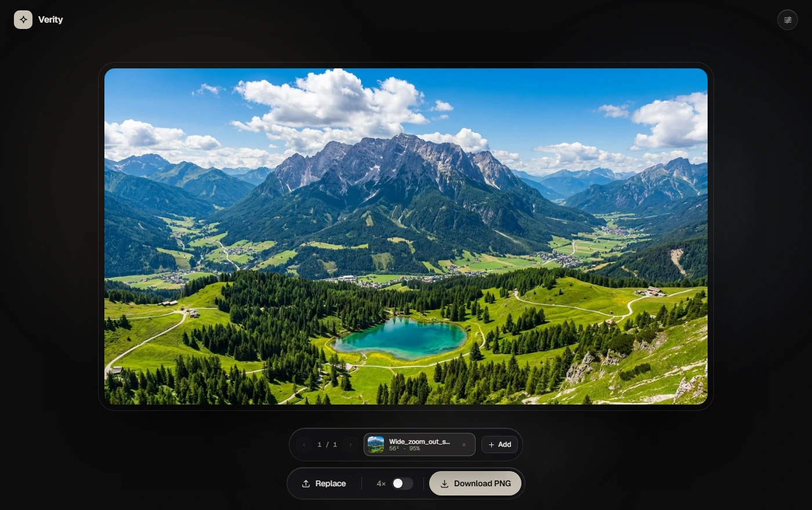
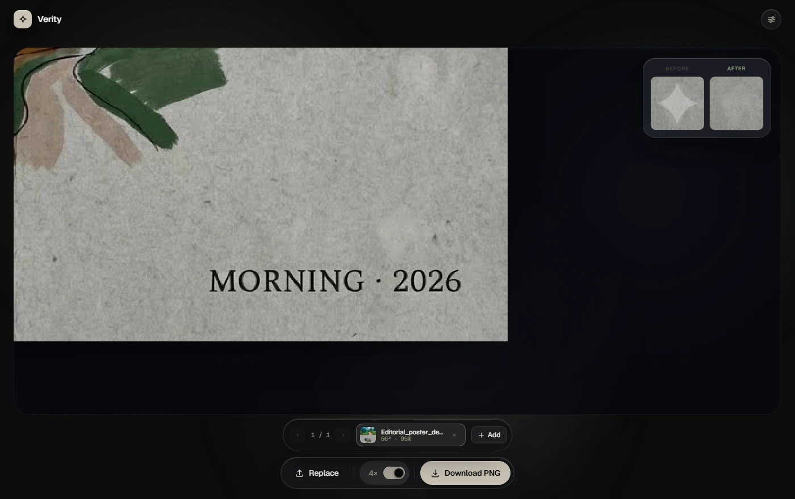
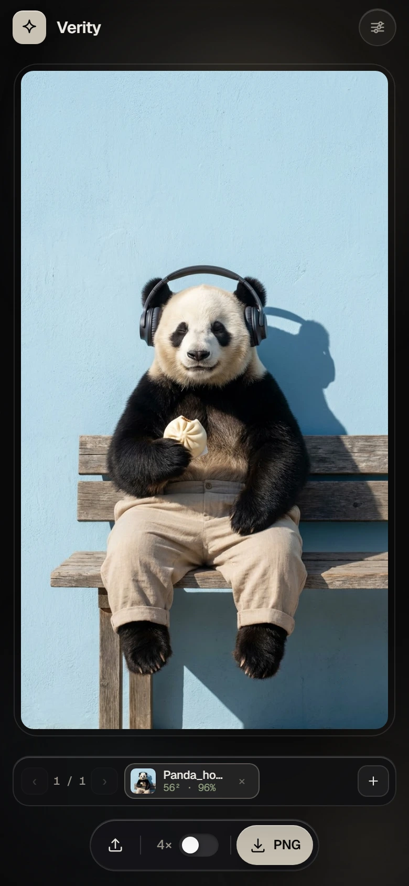

<div align="center">
  
</div>

<h1 align="center">Verity</h1>
<p align="center">
  <strong>Lossless Gemini Watermark Remover</strong><br />
  Removes the corner ✦ pixel&#8209;for&#8209;pixel — <em>not</em> by inpainting it away.
</p>

<p align="center">
  <a href="https://abinanthan-cg.github.io/verity-watermark-remover/"></a>
  
  
  
  
</p>

<p align="center">
  <a href="https://github.com/Abinanthan-CG/verity-watermark-remover/stargazers"></a>
  <a href="https://github.com/Abinanthan-CG/verity-watermark-remover/forks"></a>
  <a href="https://github.com/Abinanthan-CG/verity-watermark-remover/issues"></a>
</p>

---

## The problem

Gemini stamps a ✦ sparkle in the corner of every image it generates. The
obvious way to remove it is to crop the corner, run a diffusion model over it,
or clone-stamp from nearby pixels. All three **destroy the image** — and
diffusion models in particular smear the region into a blurry blob that gives
the whole picture away.

## How it works

The watermark isn't a texture pasted on top. It's a **known alpha blend**:

```
I_wm = (1 − α) · I + α · 255
```

where `α` is a fixed per-pixel alpha map. That equation is invertible, so
Verity just solves it backwards:

```
I = (I_wm − α · 255) / (1 − α)
```

No model, no training, no guessing. Every pixel outside the stamp comes back
**bit&#8209;for&#8209;bit identical**, and sharp detail passing *behind* the
sparkle stays razor&#8209;crisp instead of dissolving.

The two real Gemini stamps are baked into the app as ground&#8209;truth alpha
maps — a **56×56** matrix (48 px star, `α_max = 0.306`) and a **104×104**
matrix (96 px star, `α_max = 0.502`) — calibrated from lossless 1K and 2K
exports across every aspect ratio.

On top of the inversion sits a bilateral de&#8209;ringing pass that cleans up
the compression ringing JPEG leaves around the stamp, without touching the
lines underneath it.

### Proof

The 4× loupe is the engine's own before/after inspector. Turn it on with the
`4×` toggle and look at the corner:

<div align="center">
  
</div>

<p align="center"><sub>Left: the ✦ before restoration. Right: the same pixels after — no smear, no blur, no crop.</sub></p>

## Features

| Feature | What you get |
|---|---|
| **~99.9% untouched pixels** | Bit&#8209;for&#8209;bit identical outside the watermark |
| **Zero line blur** | Detail behind the stamp stays sharp — no AI smudge |
| **1K & 2K calibrated** | Native 48 px and 96 px stamps, all aspect ratios |
| **Bulk processing** | Drag in dozens of images, get one ZIP |
| **4× before/after loupe** | Verify the restoration at the pixel level |
| **Manual calibration** | Corner, stamp size, offsets, opacity gain, de&#8209;ringing |
| **Lossless PNG export** | Original dimensions preserved, never re&#8209;encoded |
| **100% private** | Images never leave your device. No server, no upload, no telemetry |
| **PWA installable** | Add it to your home screen, works offline |
| **Mobile&#8209;first** | Content&#8209;sized UI that reflows down to 320px |

### On your phone

<div align="center">
  
</div>

<p align="center"><sub>The dock and batch bar are content&#8209;sized and centred, so they hug their content and can never overflow the viewport.</sub></p>

## What it uses

| Layer | Choice | Why |
|---|---|---|
| **UI** | Vanilla HTML + CSS | No framework, no build step, no runtime to download |
| **Rendering** | Canvas 2D + `ImageData` | Direct per-pixel access — the whole method depends on it |
| **Math** | Float32 alpha maps, precomputed gradients | `Float32Array` keeps the inversion accurate without rounding drift |
| **Fonts** | Geist + Geist Mono | One variable sans, one mono, ~30 KB |
| **Icons** | Inline SVG | No icon font, no sprite sheet, no extra request |
| **Motion** | CSS transitions + `cubic-bezier` springs | GPU‑composited, respects `prefers-reduced-motion` |
| **Material** | `backdrop-filter` glass | Frosted panels over drifting colour blooms |
| **Storage** | **None** | No localStorage, no IndexedDB, no cookies, no analytics |
| **Build** | **None** | One `index.html` — HTML, CSS and JS inline |
| **Hosting** | GitHub Pages | Static files, HTTPS enforced, CDN&#8209;backed |
| **PWA** | Web App Manifest | Installable, maskable icons, share target |
| **SEO** | JSON‑LD `@graph`, OG, sitemap | `Organization` · `WebSite` · `WebPage` · `WebApplication` |

> **Note** — Verity removes the *visible* ✦ overlay only. Invisible SynthID
> and C2PA metadata are not touched.

## Privacy

There is no backend. The entire tool is the page you're reading: your image is
decoded into a canvas, inverted in place, and handed back to you as a PNG.
Nothing is uploaded, nothing is logged, there are no third&#8209;party requests
except the Google Fonts stylesheet.

## Try it

Drop in a PNG, JPEG or WebP. If the corner looks wrong, the **Advanced
calibration** panel lets you move the stamp, resize it, adjust the opacity
gain and re-run the restoration until the corner is exactly right.

## Contributing

Issues and pull requests are welcome — especially **calibration data for Gemini
stamps we haven't seen yet** (different regions, new models, unusual
resolutions). Open an issue with the image and the parameters the tool
reported.

## License

MIT © [Abinanthan-CG](https://github.com/Abinanthan-CG)

<p align="center">
  <sub>Verity is an independent project and is not affiliated with, endorsed by, or supported by Google.</sub>
</p>
